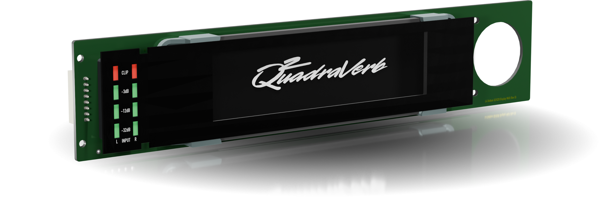

# Coming Soon

Replacement display for the Alesis Quadraverb 2 and Q20 units, using a modern RGB bar-style display.

This is an evolution of the replacement display originally designed by Nick Barton and [offered previously](https://bmamps.com/v01/2018/10/26/alesis-quadraverb-q2/) under his company Black Magic Amplifiers. 

Original Q2 displays are custom LCD panels designed specifically by Alesis, and they tend to fail due to age. No direct replacements exist like other character displays. This project represents a complete plug and play replacement solution, and includes hardware (PCB, 3D Prints, Front Panel) and firmware.

This project will be open-source! Sources are being prepared for sharing here and will be posted in the coming weeks.

In the mean time, if you have acquired a unit from my small batch, see the [installation guide](/InstallationGuide.md).

